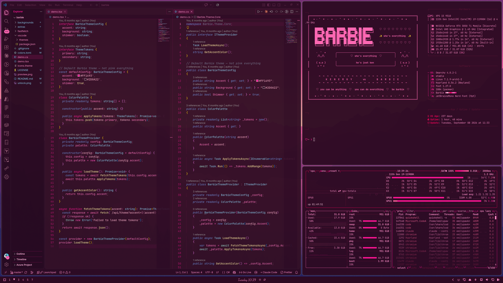

# Omarchy Barbie Theme

A Barbie-inspired dark theme for [Omarchy](https://omarchy.org/) with deep violet-pink backgrounds, hot pink accents, sky blue class names, royal blue modifiers, and pastel yellow method names. Includes a matching VS Code theme.



## Install

```bash
omarchy theme install https://github.com/BBIEPavkov/omarchy-barbie-theme
```

Then apply it:

```bash
omarchy theme set barbie
```

Requires Omarchy 4 (Quattro) and the `Yaru-magenta` icon theme.

## Light Mode

For daytime, use the light [Omarchy Barbie Malibu theme](https://github.com/BBIEPavkov/omarchy-barbie-malibu-theme): pastel pink backgrounds with deep berry text and ocean blue highlights.

```bash
omarchy theme install https://github.com/BBIEPavkov/omarchy-barbie-malibu-theme
omarchy theme set barbie-malibu
```

Switch between the two any time with `omarchy theme set barbie` and `omarchy theme set barbie-malibu`.

## Colors

| Role | Color |
|------|-------|
| Background | `#2D0A22` (deep violet-pink) |
| Foreground | `#FF8EC8` (bold pink) |
| Accent | `#FF1493` (hot pink) |
| Cursor | `#FF69B4` (hot pink) |

## VS Code Theme

A matching VS Code theme is included in the `vscode/` folder.

**Install manually:**

```bash
ln -s ~/.config/omarchy/themes/barbie/vscode ~/.vscode/extensions/omarchy-barbie-theme
```

Then reload VS Code and select **Omarchy Barbie** from the theme picker (`Ctrl + Shift + P` → Preferences: Color Theme).

**Syntax highlighting includes:**
| Element | Color |
|---------|-------|
| Modifiers (`public`, `private`, `async`) | Royal blue |
| Class / type names | Sky blue |
| Method names | Pastel yellow |
| Strings | Light pink |
| Numbers | Pastel yellow |
| Control flow (`await`, `return`) | Mint |
| Comments | Faded pink, italic |

## Obsidian

Omarchy themes Obsidian automatically. This theme adds heart bullet points, a heart before each top-level heading, pink highlights, and dividers made of hearts.

## Discord

For [Vencord](https://vencord.dev) or Vesktop: copy `vencord.theme.css` into Vencord's themes folder, then turn it on under Settings → Themes.

```bash
cp ~/.config/omarchy/themes/barbie/vencord.theme.css ~/.config/Vencord/themes/barbie.theme.css
```

## Extras

The theme sets colors, wallpapers, a hot pink window border, and the boot screen logo. A Barbie lock screen, heart bar, heart popups, pink cursor, fastfetch logo, and more are in the separate [Omarchy Barbie Extras](https://github.com/BBIEPavkov/omarchy-barbie-extras) repo.

## Wallpapers

Cycle through them with `Super + Ctrl + Space` or `omarchy theme bg next`. Add your own to `~/.config/omarchy/backgrounds/barbie/`; that folder survives theme updates.

Photos from [Unsplash](https://unsplash.com), free to use under the [Unsplash License](https://unsplash.com/license):

| File | Photographer |
|------|--------------|
| `pink-blossoms.jpg` | [Mi Min](https://unsplash.com/photos/pkpqoBp11Jc) |
| `pink-clouds.jpg` | [Xinyi Wen](https://unsplash.com/photos/qjCHPZbeXCQ) |
| `pink-sky-bridge.jpg` | [Anders Jildén](https://unsplash.com/photos/AkUR27wtaxs) |
| `dark-silk-waves.jpg` | [Pawel Czerwinski](https://unsplash.com/photos/ZkzobNDayXo) |
| `pink-abstract-hills.jpg` | [Martin Martz](https://unsplash.com/photos/XsVT2hGsSyQ) |
| `pink-smoke.jpg` | [engin akyurt](https://unsplash.com/photos/Eh0JqXcWY5g) |
| `blossom-burst.jpg` | [Anita Austvika](https://unsplash.com/photos/R-p7nxAna5Q) |
| `blossoms-blue-sky.jpg` | [AJ](https://unsplash.com/photos/McsNra2VRQQ) |
| `cherry-branch.jpg` | [Tsz Chung Cheng](https://unsplash.com/photos/MEgGgIpNoho) |
| `lavender-moonrise.jpg` | [Dan LeFebvre](https://unsplash.com/photos/BnLNqGSnLs4) |
| `misty-pink-ridges.jpg` | [Arno Senoner](https://unsplash.com/photos/NrUdF73jklw) |
| `pink-clouds-moon.jpg` | [John Thomas](https://unsplash.com/photos/HYAnBGL77eo) |
| `pink-clouds-peaks.jpg` | [Marsumilae](https://unsplash.com/photos/4NXUWw0GXx4) |
| `pink-sky-snowy-peaks.jpg` | [Tory Hoffman](https://unsplash.com/photos/-rY1rsPimmg) |
| `purple-mountain-sunset.jpg` | [Олег Мороз](https://unsplash.com/photos/68ZCl8jClYs) |

## Disclaimer

Barbie is a trademark of Mattel, Inc. This is an unofficial fan theme and is not affiliated with or endorsed by Mattel.
